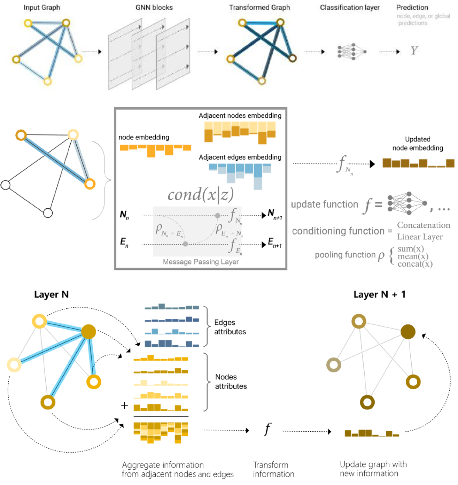

# GIGNN

论文提出的地理信息图神经网络（GIGNN）的 Python 实现，用于空间模拟与预测。

[English](README.md) | **简体中文**

[](LICENSE)
[](pyproject.toml)
[](https://pytorch.org)
[](https://pyg.org)
[](docs/RELEASE.md)

## 为什么是 GIGNN

空间数据通常以表格形式到来：每行一个区域、格网或样点，列是 NDVI、DEM、土地利用统计、人口、路网密度这类数值指标。用随机森林或梯度提升来分类这样的表，你大概已经很熟。这些模型把每一行当作互相独立——而这正是本库要补的那块短板。

地理实体并不独立。实体之间的连接本身携带信息，这些连接构成一张图：每个空间单元是一个节点，相邻单元之间连一条边。图神经网络（graph neural network，GNN）能在这类结构上模拟空间相互作用。但普通 GNN 用在空间数据上有一个毛病：它默认「相邻就该互相影响」。真实地表不是这样——公园旁边可能就是商务区，相距很远、特征相似的区域反而可能互动。

GIGNN 由 Ma、Zhang 和 Song 在 2025 年提出，给 GNN 配方加上两条地理修正：

1. **边权响应特征差异。** 边权按特征距离的高斯核计算：物理相邻但特征悬殊的单元，权重被压低；特征相似的单元，跨跳仍保持影响。
2. **训练前先做特征发现。** 基于地理探测器（GeoDetector）的离散化，用**空间分层异质性**（spatial stratified heterogeneity）——特征在空间分区之间的可测差异——量化属性差别，并在消息传递开始前选出真正起作用的因子。

在论文对澳大利亚大珀斯地区的城市化分析中，GIGNN 模拟准确率达 84.1%（2016 年），泛化预测准确率达 81.0%（2021 年），对比的机器学习与图模型方法在同批任务上落后 16.5–42.7 个百分点。结果取决于数据与特征构造，你的任务可能不同。


*图：GIGNN 空间建模架构（[论文](https://doi.org/10.1016/j.spasta.2025.100920) Fig. 1）。*

本仓库封装与 notebook 对齐的 GIGNN 核心：面向空间单元表的特征发现、图构建、训练、预测、情景模拟与泛化诊断。实现范围是核心算法路径，不含论文的每个实验或外部数据集——确切边界见[实现状态](docs/zh-CN/IMPLEMENTATION_STATUS.md)。遥感影像原始下载、镶嵌、重投影、栅格采样与托管服务部署不在核心包范围内。

> Ma, X., Zhang, Z., & Song, Y. (2025). Geographically informed graph neural networks. *Spatial Statistics*, 69, 100920. [https://doi.org/10.1016/j.spasta.2025.100920](https://doi.org/10.1016/j.spasta.2025.100920)

引用本软件请使用 [CITATION.cff](CITATION.cff)（GitHub 与 Gitea 会据此渲染「引用本仓库」按钮）。

如果你用过 scikit 风格的估计器，这套 API 会很眼熟：`fit`、`predict`、`predict_proba`、`score`。下面的[快速上手](#快速上手)是最短路径，其余细节在[文档](#文档)一表里。

## 发布状态

`gignn==0.1.0` 为 beta 候选版本。公开 API 可用于本地研究与包级验证，但在稳定的 `1.0` 版本前仍可能出现小幅 API 调整。

本仓库不自动发布到 PyPI。构建与上传操作必须是显式的。

## 文档

| 文档 | 用途 |
| --- | --- |
| [LLM 短上下文](llms.txt) | 面向 LLM 与爬虫的机器可读项目短上下文（英文）。 |
| [LLM 全量上下文](llms-full.txt) | 面向长上下文 LLM 与代理的机器可读全量上下文（英文）。 |
| [实现状态](docs/zh-CN/IMPLEMENTATION_STATUS.md) | notebook GIGNN 核心实现与范围外论文复现的当前审计。 |
| [功能总览](docs/zh-CN/FEATURE_OVERVIEW.md) | 全部代码支撑能力的分层地图。 |
| [用户指南](docs/zh-CN/USER_GUIDE.md) | 从数据准备到预测与模拟的端到端工作流。 |
| [API 参考](docs/zh-CN/API.md) | 公开类、函数、报告、输入、返回与异常。 |
| [架构](docs/zh-CN/ARCHITECTURE.md) | 模块边界与内部数据流。 |
| [报告](docs/zh-CN/REPORTS.md) | 报告 dataclass 与估计器属性。 |
| [绘图](docs/zh-CN/PLOTTING.md) | 地图、诊断、指标与交互可视化。 |
| [数据契约](docs/zh-CN/DATA_CONTRACT.md) | 输入表、标签、几何、边与资源上限要求。 |
| [示例](docs/zh-CN/EXAMPLES.md) | 内置示例索引与预期行为。 |
| [命令](docs/zh-CN/COMMANDS.md) | 安装、测试、构建与包验证命令。 |
| [环境](docs/zh-CN/ENV.md) | 运行时环境与依赖上下文。 |
| [贡献指南](docs/zh-CN/CONTRIBUTING.md) | 开发工作流与 PR 检查。 |
| [发布](docs/zh-CN/RELEASE.md) | 发布检查清单与产物验证。 |
| [运维手册](docs/zh-CN/RUNBOOK.md) | 运行检查与故障排查。 |
| [安全](docs/zh-CN/SECURITY.md) | 检查点、文件路径与不可信输入边界。 |
| [代理指南](docs/zh-CN/AGENTS.md) | 面向编码代理的任务路由与验证指引。 |
| [RAG 索引](docs/zh-CN/RAG_INDEX.md) | 检索路由、分块与反幻觉指引。 |

英文原版文档见 [docs/](docs/)。

## 目录
- [目录](#目录)
- [为什么是 GIGNN](#为什么是-gignn)
- [发布状态](#发布状态)
- [文档](#文档)
- [仓库结构](#仓库结构)
- [安装](#安装)
- [快速上手](#快速上手)
- [核心能力](#核心能力)
- [验证](#验证)
- [许可](#许可)

## 仓库结构

```text
gignn/              运行时库包
tests/              回归与契约测试
examples/           可运行的冒烟示例
docs/               用户、开发、发布与代理文档
research/           论文与 notebook 证据（用于对齐审计）
.spec/              任务包、归档记录与可复用项目笔记
```

## 安装

```bash
python3.11 -m venv .venv
. .venv/bin/activate
python -m pip install --upgrade pip
python -m pip install -e '.[dev]'
```

几何密集型工作流：

```bash
python -m pip install -e '.[gis,dev]'
```

PyTorch 与 PyTorch Geometric 是核心依赖。若在你的平台上依赖解析失败，请先安装官方 PyTorch/PyG wheel 组，再重新安装 GIGNN。

## 快速上手

`X` 是数值指标表（每行一个空间单元），`y` 是有序分类目标（如 `["low", "medium", "high"]`），`geometry` 是可选几何列；确切要求见[数据契约](docs/DATA_CONTRACT.md)。

```python
from gignn import GIGNNAutoClassifier

model = GIGNNAutoClassifier(
    detector_grid={"discretizer": ["quantiles"], "max_bins": [3]},
    graph_grid={"strategy": ["knn"], "k": [4]},
    model_grid={"hidden_channels": [(64,)], "learning_rate": [0.01], "max_epochs": [100]},
    random_state=42,
)
model.fit(X, y, geometry=geometry, class_order=["low", "medium", "high"])

predictions = model.predict(X_new, geometry=geometry_new)        # 类别标签
print(model.discovery_report_.selected_features)                 # 地理探测器选特征
print(model.graph_report_.selected_strategy)                     # 如 knn(k=4)
print(model.model_selection_report_.best_params)                 # 调优后的 GNN 参数
print(model.generalization_report_.accuracy)                     # 留出集准确率
```

模拟、概率输出与研究产物导出都基于同一个拟合后的模型继续——见[用户指南](docs/USER_GUIDE.md)与[示例](docs/EXAMPLES.md)。

如需可运行的端到端脚本（自带数据），执行内置冒烟示例，预期最后一行输出类似 `plotting: generated histogram, training-curve, and accuracy-comparison figures`：

```bash
.venv/bin/python examples/quickstart.py
```

## 核心能力

GIGNN 按九个能力层组织：

| 层 | 主要 API | 作用 |
| --- | --- | --- |
| 数据标准化 | `standardize_spatial_dataset` | 构建数值特征矩阵、目标序列、可选 ID、可选几何与数据集报告。 |
| 地理探测器发现 | `spatial_discretization`、`factor_detector`、`interaction_detector`、`GeoDetectorSelector` | 连续变量离散化、因子 q 统计评分、成对交互探测与特征选择。 |
| 图构建 | `build_spatial_edges`、`build_adjacency_dict`、`calculate_gaussian_edge_attributes`、`calculate_edge_weights`、`filter_isolated_nodes` | 校验显式 `edge_index` 输入，或按 `knn`、`distance`、`contiguity` 从几何构建图，再推导高斯边属性与可用边权。 |
| PyG 转换 | `build_pyg_data` | 把数值特征、标签、图边、可选 `edge_attr` 与可选 `edge_weight` 转换为 `torch_geometric.data.Data`。 |
| GNN 训练 | `GIGNNClassifier`、`GIGNN`、`GraphSAGEClassifier`、`train_node_classifier` | 训练与 notebook 对齐的加权多跳 GIGNN 节点分类器（类权重、确定性种子、验证检查）；`GraphSAGEClassifier` 保留为更低层的模型。 |
| 自动工作流 | `GIGNNAutoClassifier` | 搜索发现、图与模型网格，并暴露可追溯报告。 |
| 研究产物导出 | `export_research_artifacts`、`GIGNNAutoClassifier.export_research_artifacts` | 写出原始/预处理/过程/结果证据包，支撑科学可复现。 |
| 诊断与模拟 | `generalization_diagnostics`、`morans_i`、`cross_validate`、`model_accuracy_table`、`simulate` | 度量预测准确率、偏差、残差空间自相关、直推式 k 折指标、分类报告与情景变化。 |
| 绘图 | `plot_*` 函数 | 产出地图、对比、直方图、训练曲线、指标与交互网络的 Matplotlib 图。 |

完整层级见[功能总览](docs/FEATURE_OVERVIEW.md)。

关于 notebook GIGNN 核心是否已实现的准确回答，见[实现状态](docs/IMPLEMENTATION_STATUS.md)。

## 验证

```bash
.venv/bin/python -m pytest
.venv/bin/python -m build
.venv/bin/python examples/quickstart.py
```

使用 `.venv/bin/python` 或其他已安装项目依赖的 Python `>=3.10` 环境。macOS 系统 `python3` 可能是 Python 3.9，不满足本项目要求。

## 许可

[MIT](LICENSE)
